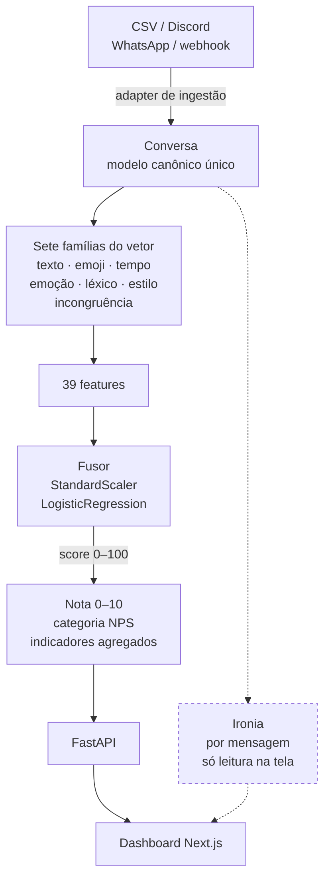
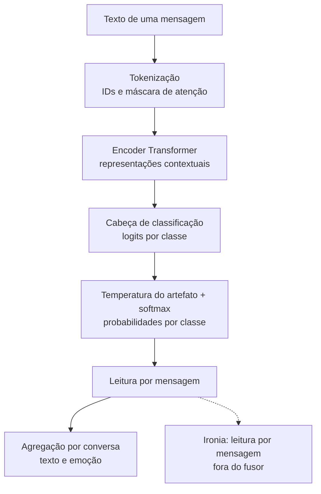
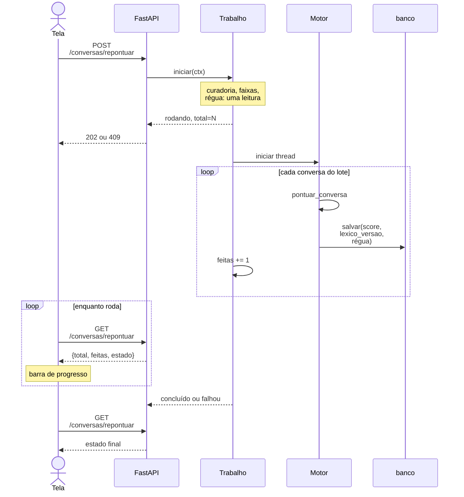

# Arquitetura

*\* a cabeça de ironia é lida por mensagem e mostrada na tela, mas **não
entra** nas 39 features do Fusor — ver a seção abaixo.*

São **oito famílias de sinais**, não oito cabeças neurais: satisfação textual,
emoção e ironia usam três classificadores; as demais famílias são calculadas.
Sete famílias alimentam o fusor. A ausência de fala informativa do cliente
produz score nulo, nunca zero.

## Dentro de uma cabeça Transformer

**Equivalente textual:** o tokenizador converte o texto em identificadores de
tokens e indica quais posições são válidas. O encoder constrói representações
contextuais; a cabeça de classificação as transforma em logits das classes.
A temperatura, quando registrada no artefato, ajusta a escala desses logits
antes do softmax. A saída é uma distribuição de probabilidades, não uma nota
da conversa. Texto e emoção entram em agregações de suas famílias; ironia
segue para leitura por mensagem. Emoção tem sete classes treinadas e desprezo
derivado da díade raiva + nojo. Não se fixa aqui número de camadas ou dimensões
sem metadados do checkpoint.

O explorador da tela **Modelo** é um esquema didático desse fluxo. A simulação
de uma frase mostra somente os sinais devolvidos pela classificação; não mede
tempo, não processa uma conversa completa e não calcula o score do fusor.
Selecionar uma etapa não é executar inferência.

### Quatro coisas diferentes que a visualização não deve confundir

| grandeza | significado | limite |
|---|---|---|
| Probabilidade por classe | saída de uma cabeça para a mensagem, ou do fusor para suas classes | confiança do modelo, não verdade sobre o cliente |
| Peso global | coeficiente aprendido pelo fusor para uma feature padronizada | não é a importância causal de uma palavra ou o efeito fixo em pontos |
| Contribuição local em logits | coeficiente multiplicado pela feature padronizada daquela conversa | soma com o intercepto em cada logit; não soma diretamente o score |
| Ativações e atenção internas | estados intermediários do Transformer | não são expostos pela API nem observados pelo esquema didático |

O fusor **não é uma rede densa ilustrativa**: as 39 features passam pelo
`StandardScaler` e pela regressão logística. O softmax e a projeção em score
são não lineares; contribuições por família não demonstram causalidade.
Esquema e saídas reais não autorizam desenhar “palavras que causaram a nota”.

## A decisão que explica o desenho

**Um modelo canônico, muitos adaptadores.** CSV, Totalk, transcrição de
`.docx`/`.pdf` e webhook desembocam todos em `Conversa` — e o resto do sistema
não sabe de onde o dado veio. Adicionar uma fonte é escrever um adaptador, não
tocar em sinal, fusor ou indicador.

## As sete famílias que pontuam

| família | o que mede | por que existe |
|---|---|---|
| **texto** | P(insatisfeito/neutro/satisfeito) por mensagem | o sinal principal — o único fine-tunado para a tarefa |
| **emoji** | polaridade e **posição relativa** | emoji no fim da conversa não vale o mesmo que no começo |
| **tempo** | latências, escalação, abandono | espera longa degrada satisfação (literatura de live chat) |
| **emoção** | 6 emoções básicas de Ekman + neutro, e desprezo derivado de raiva + nojo | raiva e frustração distinguem *tipos* de insatisfação |
| **léxico** | SentiLex-PT02 com escopo de negação | âncora determinística, auditável, imune a retreino |
| **estilo** | caixa alta, alongamento, palavrão, censura | intensidade que o classificador de sentença perde |
| **incongruência** | elogio convivendo com situação negativa | é o que alcança a frase canônica do projeto |

## Onde roda, e com que motor

| | |
|---|---|
| **Backend dos modelos** | `FRAUS_BACKEND=torch` (padrão), `onnx` — os mesmos checkpoints, sem torch em runtime — ou `onnx-multitarefa` (candidato, não promovido); valor desconhecido é erro de boot |
| **Cabeça de ironia** | `FRAUS_IRONIA_BACKEND`: `padrao` (BERTimbau), `laya` ou `laya-onnx` — troca só a leitura por mensagem; a ironia não entra no score |
| **Motor** | carregado por um provedor preguiçoso (`ProvedorDeMotor`): `frio` → `carregando` → `pronto` ou `erro`, sem fallback para dublê |
| **Aquecimento** | a carga começa em segundo plano no boot e a cada `GET /saude`; `GET /saude/prontidao` só dá 200 com o motor pronto |
| **Produção** | dashboard e API em dois projetos Vercel, estado no Supabase Postgres; a API é serverless e **esfria** |

O aquecimento reduz o cold start e não o elimina. Para eliminá-lo, a API precisa
de um container sempre ligado (ver [Limitações](limitacoes.md)).

## A ironia continua carregada, e não pontua

A família de ironia usa uma das **três cabeças neurais** e é obrigatória no
**motor de inferência**, não para a API subir. A API pode estar no estado frio,
carregando ou erro; predição exige todos os artefatos válidos, sem fallback.
A ironia aparece na tela **por mensagem**, mas **saiu do vetor** em 04/09/2026.

Em medição histórica no corpus de treino do fusor (B2W-Reviews01), ela marcou **74% das
resenhas satisfeitas** como irônicas contra **9% das insatisfeitas**: naquele
corpus ela é um detector de sentimento **positivo**, não de ironia. O fusor
aprendeu peso **+0,77** para `ironia_prob_media`, empurrando ironia para
*satisfeito* — o inverso do que o nome promete.

> **Feature que mede outra coisa que não o nome dela é pior que feature
> ausente.** Ela some do vetor sem que ninguém perceba a inversão, porque a
> acurácia global continua ótima.

Ver [Treinamento](treinamento.md) para a medição completa.

## Régua: o que pontuou uma conversa não é fixo no tempo

Cada conversa é gravada com a **régua** que a pontuou: a assinatura do motor
servindo (`Motor.regua`, `None` no motor dublê) mais a versão da curadoria
(`lexico_versao`). Trocar de checkpoint, trocar de backend (torch/onnx) ou o
analista ensinar um termo novo ao léxico muda a régua — e o banco passa a ter
conversas antigas pontuadas por uma régua que não é mais a vigente.

O sistema não recalcula sozinho: ele **avisa**. `GET /indicadores` expõe
`pontuadas_com_regua_antiga`, contando contra a régua vigente lida a cada
requisição (nunca guardada em memória, pelo mesmo motivo de `faixas_vigentes`
e `curadoria_vigente` — sem cópia de estado envelhecendo). A tela mostra o
aviso com o motivo (checkpoint novo, léxico curado, ou os dois), nunca um
número solto sem explicação.

## Repontuar é um trabalho, não uma requisição

Zerar o aviso de régua misturada significa rodar os três BERTimbau de novo em
cada conversa do banco — em milhares de atendimentos isso estoura qualquer
timeout HTTP. `POST /conversas/repontuar` (`fraus/api/repontuacao.py`) só
dispara uma thread em segundo plano; `GET /conversas/repontuar` lê o progresso
(`total`, `feitas`, `estado`, `erro`) que a tela transforma em barra. Não é
fila — é **um trabalho por vez**: uma segunda chamada enquanto a primeira roda
recebe 409, porque duas repontuações em paralelo gravariam o mesmo banco com
duas curadorias diferentes. O estado mora na memória do processo (reiniciar a
API no meio perde o progresso, não o que já foi gravado — cada conversa salva
já carrega sua própria `lexico_versao` e régua).

## A explicação da nota

`GET /conversas/{id}/atribuicao` devolve também o campo `explicacao`: a
decomposição exata do fusor (intercepto e contribuições por feature, somando no
logit), o efeito por família e frases geradas por template — nenhum LLM. Duas
rotas completam o E1: `POST /conversas/{id}/contrafactual` refaz a nota
mudando só o relógio (e recusa o que sai de `|z| ≤ 4`) e
`GET /indicadores/drivers` agrega os efeitos numa amostra com semente. Nenhuma
das três grava; o score, a nota e a categoria gravados não mudam. A lógica de
texto fica em `fraus/explicacao.py`; os limites estão em
[Limitações](limitacoes.md).

## Confiança: conjunto conformal e abstenção

Duas rotas somente leitura, que não gravam e não alteram score, nota nem
categoria: `GET /conversas/{id}/confianca` (conjunto de classes e o marcador de
abstenção da conversa) e `GET /indicadores/confianca` (agregado, só pelo
critério do conjunto; conversas de outra régua ficam fora e vêm contadas em
`defasadas`). A lógica pura está em `fraus/conformal.py`; as métricas de
calibração, em `fraus/calibracao.py`.

O artefato é `fraus/dados/conformal_fusor.json`, versionado, fora de `modelos/`,
chaveado pela régua (`regua_do_fusor`: fusor mais regra de cortesia). Contrato
de falha: sem artefato, artefato malformado ou régua diferente da vigente, as
duas rotas respondem **503 com o motivo**; no detalhe, uma conversa pontuada por
outra régua responde 409. Conjunto vazio conta como abstenção. Conversa sem
score tem conjunto `null` e não entra na contagem. Indicadores e demais rotas
não dependem do artefato. Limites em [Limitações](limitacoes.md).

## Sinalizadores por regra

`sinalizadores` é derivado na leitura, em `_com_derivacoes`, por
`fraus/sinalizadores.py`: cinco regras de risco sobre a estrutura da conversa,
sem gravar coluna nem chave de payload e sem ler o texto ou o relógio da fala
humana. Conversa sem fala do cliente devolve `null` (não avaliada), nunca lista
vazia. `GET /conversas?sinalizador=<regra>` filtra e só então pagina. Limites em
[Limitações](limitacoes.md).

## Impacto por tema e deterioração

`GET /operacao/radar` traz, em cada tema, o impacto no NPS inferido com IC por
bootstrap (`fraus/impacto.py`): associação, não causa, nulo abaixo de 30
conversas com sinal em cada lado. `GET /operacao/replay/{id}` traz o início
retrospectivo da deterioração (`fraus/deterioracao.py`, campo `indice_virada`) sobre os scores por prefixo que o replay
já calcula: derivada na leitura, nada gravado, nunca alerta ao vivo. Limites em
[Limitações](limitacoes.md).

## Onde cada coisa mora

| caminho | responsabilidade |
|---|---|
| `fraus/modelos.py` | `Conversa` / `Mensagem` — o modelo canônico |
| `fraus/ingest/` | adaptadores de entrada, um por formato |
| `fraus/sinais/` | as oito famílias de sinal |
| `fraus/sinais/curadoria.py` | o que o analista ensinou ao léxico — vence o SentiLex |
| `fraus/fusor.py` | `NOMES_FEATURES` (39) e o `Fusor` |
| `fraus/indicadores.py` | NPS, CSAT, contenção, falso containment, série |
| `fraus/explicacao.py` | frases por template a partir da decomposição do fusor, e os drivers agregados |
| `fraus/evidencia.py` | evidência fraca — a cabeça tracejada |
| `fraus/deriva.py` | deriva de distribuição — a invariante 10 em runtime |
| `fraus/cortesia.py` | "ok, obrigado" sozinho é sem sinal, não promotor |
| `fraus/api/` | FastAPI: `criar_app` (fábrica) e as rotas por domínio |
| `fraus/api/contexto.py` | faixas, curadoria e régua vigentes, lidas por requisição |
| `fraus/api/repontuacao.py` | repontuar em segundo plano, com progresso e 409 se já rodando |
| `fraus/api/vazao.py` | teto de `/auth/*` por IP e de `/ingestao` por fonte |
| `dashboard/` | Next.js — ver [Design](design.md) |
