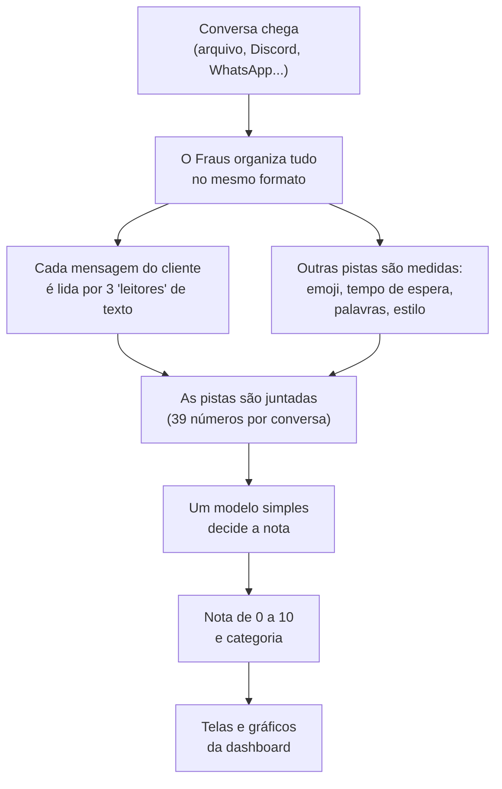
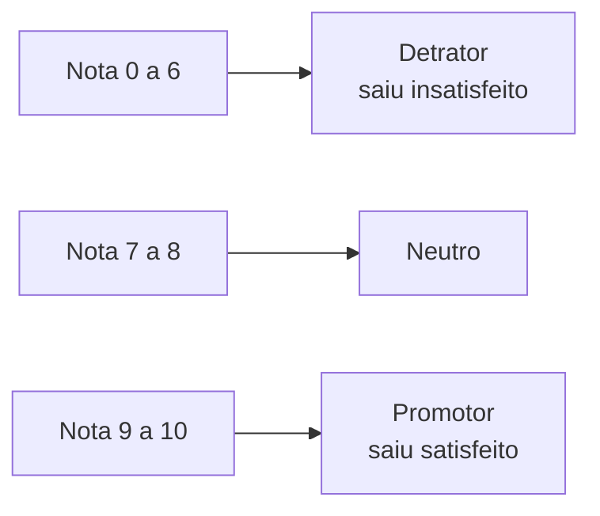
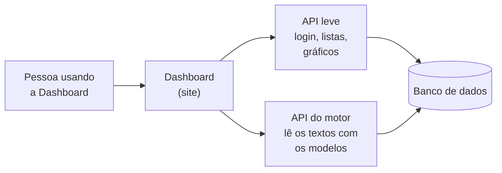
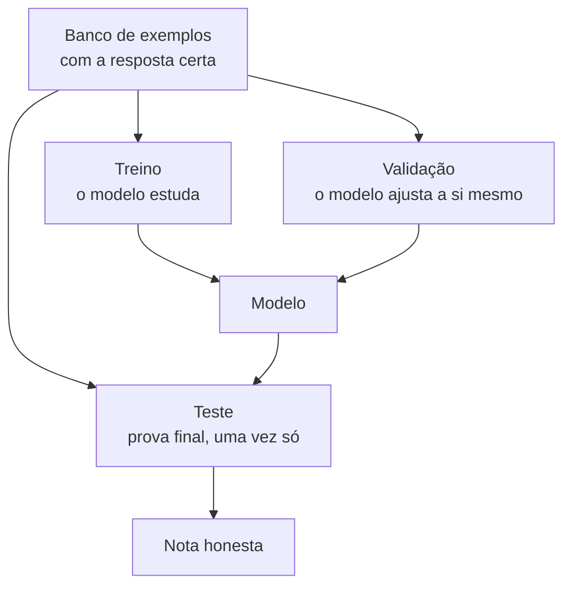
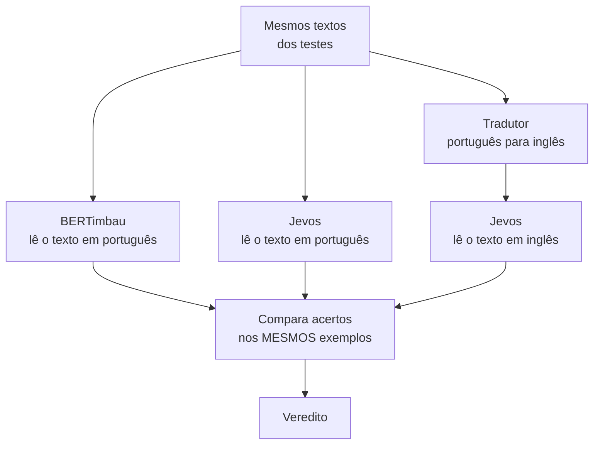
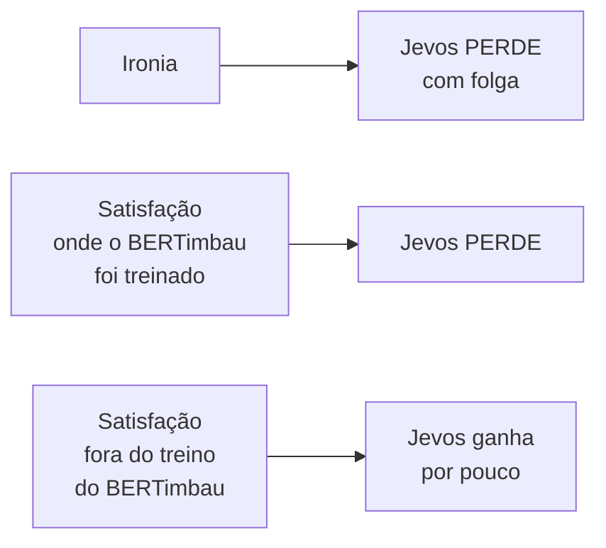

# O Fraus explicado para todos

Esta página é para quem **não programa**. Ela conta, em ordem: qual foi a ideia,
como o sistema funciona por dentro (com desenhos), como a gente testou se ele
acerta, e o que ele **não** consegue fazer. Quem quiser os detalhes técnicos
encontra os links no fim de cada parte.

---

## 1. A ideia principal

Quando você fala com o chatbot de uma empresa, ela quase nunca descobre **se
você saiu satisfeito**. Existem dois jeitos comuns de tentar saber, e os dois
têm problema:

| jeito de medir | o problema |
|---|---|
| **Pesquisa** ("de 0 a 10, quanto você recomenda?") | quase ninguém responde, e quem responde costuma ser quem ficou muito feliz ou muito bravo |
| **Contenção** ("o bot resolveu sem passar para um humano?") | não diferencia quem **foi resolvido** de quem **desistiu e foi embora** |

**A ideia do Fraus:** em vez de perguntar, *ler a conversa*. Um cliente deixa
pistas sem querer: as palavras que escolhe, os emojis, quanto tempo esperou, se
escreveu em CAIXA ALTA, se parou de responder de repente. O Fraus junta essas
pistas e **estima** uma nota.

!!! warning "Estimativa, não resposta do cliente"
    O Fraus **não sabe** o que o cliente sentiu. Ele faz uma estimativa, como um
    atendente experiente que lê o histórico e diz "esse aqui provavelmente saiu
    chateado". Por isso toda tela do Fraus mostra a etiqueta **NPS inferido**.

### A regra de ouro do projeto: sem IA gigante na hora de usar

Hoje muita gente resolve tudo mandando o texto para um assistente de IA grande
(como o ChatGPT). **O Fraus não faz isso, de propósito.** Os modelos que ele usa
são pequenos, rodam no próprio computador e **não mandam a conversa para fora**.

Por quê? Porque a pergunta do nosso trabalho é justamente: *"dá para medir
satisfação só com modelos pequenos e explicáveis?"* Se a gente chamasse uma IA
gigante, o sistema até poderia ficar melhor, mas a gente deixaria de responder
à pergunta que o trabalho se propôs a responder.

---

## 2. O que acontece por dentro

### 2.1 O caminho de uma conversa, do começo ao fim

Em português simples:

1. **A conversa chega** de qualquer lugar. O Fraus converte tudo para um único
   formato, para o resto do sistema não precisar saber de onde veio.
2. **Três "leitores" de texto** olham cada mensagem do cliente: um estima se ela
   é de **satisfação ou insatisfação**, outro identifica **a emoção** (raiva,
   alegria, tristeza...), outro olha **ironia**.
3. **Outras pistas** são medidas por contas simples: tempo de espera, emojis,
   palavras de um dicionário de sentimentos, CAIXA ALTA, palavrão.
4. Tudo vira uma lista de **39 números** que descreve aquela conversa.
5. Um **modelo simples** (uma regressão logística, uma conta parecida com uma
   balança de pesos) olha os 39 números e dá a nota.
6. A nota vira **categoria** e aparece nos gráficos.

### 2.2 As categorias de nota

É a mesma divisão do NPS tradicional. O **NPS** é uma conta: porcentagem de
promotores **menos** porcentagem de detratores.

### 2.3 As sete famílias de pistas

Pense em um **júri de sete jurados**. Cada um olha a conversa de um ângulo
diferente, e a nota final nasce da opinião de todos juntos.

| jurado | o que ele observa | exemplo do dia a dia |
|---|---|---|
| **Texto** | o sentido das palavras | "adorei" × "péssimo" |
| **Emoji** | qual emoji e **onde** na conversa | 😡 no fim pesa mais que no começo |
| **Tempo** | quanto o cliente esperou, se desistiu | esperar 3 horas irrita |
| **Emoção** | raiva, alegria, tristeza... | raiva e frustração são insatisfações diferentes |
| **Dicionário** | palavras positivas e negativas, com negação | "não gostei" ≠ "gostei" |
| **Estilo** | CAIXA ALTA, "!!!", palavrão, "aaaaaah" | quanto o cliente está alterado |
| **Contradição** | elogio misturado com situação ruim | "que atendimento ótimo, só esperei 3 horas" |

A **ironia** é lida e aparece na tela, mas **não entra na nota**. A gente
descobriu que, nos dados de treino, ela estava confundindo "ironia" com "gente
satisfeita" (ver o quadro abaixo), e uma pista que mede outra coisa é **pior**
que nenhuma pista.

!!! info "Por que a ironia ficou de fora da nota"
    Em uma medição, o leitor de ironia marcou **74%** das avaliações
    satisfeitas como irônicas e só **9%** das insatisfeitas. Ou seja: ele
    aprendeu a reconhecer "texto positivo", não "ironia". Se ele ficasse na
    nota, empurraria a nota para o lado errado sem ninguém perceber.

### 2.4 Onde a conta roda

Desde novembro a API foi dividida em **duas partes**: uma **leve**, que só mexe
com login, listas e gráficos (rápida para abrir), e uma **pesada**, que carrega
os modelos de leitura. Antes era uma só, e todo clique esperava os modelos
carregarem.

**Leia mais:** [A tese](tese.md) · [Arquitetura](arquitetura.md)

---

## 3. As regras que não podem ser quebradas

O projeto tem 10 regras (as [invariantes](invariantes.md)). Cada uma nasceu de
um **erro real**. As cinco que mais importam para entender o trabalho:

| regra | em uma frase | por quê |
|---|---|---|
| **Sem IA gigante em tempo real** | o sistema roda no próprio computador | é a pergunta do trabalho |
| **Sem dado não é insatisfação** | conversa sem fala do cliente aparece como **"sem sinal"**, nunca como nota 0 | zero parece uma nota medida, e não foi |
| **A nota é calculada no servidor** | a tela nunca recalcula | já gerou divergência de arredondamento |
| **O corpus não pode entregar a resposta** | não vale treinar com dados em que o gabarito está escrito na pista | o primeiro modelo acertou 99% só olhando o relógio, o que era golpe, não inteligência |
| **Não pontuar atendente** | o Fraus mede o **atendimento**, não a **pessoa** | é limite ético e de lei (veja [conformidade](conformidade.md)) |

!!! tip "Acurácia alta demais é suspeita"
    Se um modelo acerta 99%, a primeira pergunta é "onde ele está colando?".
    O projeto trata resultado perfeito como **sintoma**, não como vitória.

---

## 4. Como a gente testou

Treinar um modelo e ver que ele acerta **no próprio treino** não prova nada,
como estudar só pela prova de anos anteriores. Por isso os testes têm regras.

### 4.1 A regra da prova justa

- **Treino:** o modelo estuda aqui.
- **Validação:** serve para escolher o melhor entre as tentativas.
- **Teste:** a "prova final". **Nunca** pode ter aparecido no estudo.

Além disso, quem escreve os exemplos **não pode estar nos dois lados**. Se a
mesma pessoa (ou o mesmo produto) aparece no treino e no teste, o modelo "decora
o estilo" e o resultado fica inflado. O projeto confere isso por código e
**para com erro** se a divisão sair errada.

### 4.2 Com o que a gente testou

| tarefa | de onde vêm os exemplos | para que serve |
|---|---|---|
| **Satisfação** | **B2W** (avaliações de produto) | treino e teste "da casa" |
| **Satisfação** | **ConsumerBR** (reclamações de consumidor) | teste **de fora**: dados que o modelo nunca viu |
| **Emoção** | **GoEmotions** em português | treino e teste "da casa" |
| **Emoção** | **XED-pt** (legendas de filme) | teste **de fora** |
| **Ironia** | **MultiPICo** (respostas de redes sociais) | teste **de fora** |
| **Conversa inteira** | conversas **sintéticas** (montadas por nós) | o modelo que junta as pistas |

!!! warning "Uma limitação que precisa ser dita"
    O **tempo de espera** das conversas de treino é **simulado**, porque não
    existe base pública em português com conversas reais e horários. Então os
    números do modelo final medem como ele se comporta **nesse cenário
    montado**, não em atendimento real de uma empresa. Isso está declarado no
    projeto, não escondido.

### 4.3 Os resultados, sem enfeite

Os números abaixo são do **leitor de texto de satisfação** (o principal),
medidos em uma amostra de 5.000 exemplos de cada teste. **F1** é uma nota de 0
a 1 que mistura "quanto acerta" e "quanto não deixa de ver"; quanto mais perto
de 1, melhor.

| teste | o que é | F1 | leitura simples |
|---|---|---:|---|
| **B2W** | dados "da casa" | **0,76** | vai bem onde foi treinado |
| **ConsumerBR** | dados "de fora" | **0,54** | cai bastante fora de casa |

**O que isso quer dizer:** o modelo funciona bem no tipo de texto em que
estudou (avaliação de produto) e **piora** em texto diferente (reclamação de
consumidor). Isso se chama **perda de generalização**, e a gente mostra, em vez
de esconder.

Também treinamos cada leitor **três vezes** com sorteios diferentes e olhamos
a média, para não confiar na sorte de uma tentativa só. O detalhe completo, com
as tabelas, está em [Generalização e evidências](generalizacao.md).

---

## 5. O experimento com o Jevos

### 5.1 O que é o Jevos e por que testamos

O **Jevos** é uma IA pequena, que roda no computador e responde perguntas de
"sim/não" e de escolha. É parecido com um ChatGPT pequeno. A pergunta foi:

> *Um modelo desses, **sem treino nenhum** para o nosso problema, consegue
> ganhar do nosso modelo (o BERTimbau) em satisfação e em ironia?*

!!! info "Isso é um teste de pesquisa, não uma mudança no produto"
    O Jevos **não está** dentro do Fraus. Rodamos o teste à parte. E, mesmo que
    ele ganhasse, usá-lo exigiria **quebrar a regra de ouro** (nada de IA
    gigante em tempo real), que é requisito do trabalho.

### 5.2 Como foi feito

O Jevos **só entende inglês**. Por isso testamos de **dois jeitos**: lendo o
texto em português cru, e lendo o texto **traduzido** para o inglês por um
tradutor automático. Os dois modelos leem **exatamente os mesmos exemplos**.

**O critério foi escrito antes de medir:** o Jevos só seria considerado melhor
se, no teste **de fora**, a vantagem dele sobrevivesse a uma checagem
estatística (o "intervalo de confiança", que é uma faixa de erro: se a faixa
inteira fica acima de zero, a vantagem é real e não sorte).

### 5.3 O resultado

Na tabela, **diferença de F1** = nota do Jevos **menos** nota do BERTimbau.
Número **negativo** = o Jevos perdeu.

| tarefa | teste | Jevos em português | Jevos traduzido |
|---|---|---:|---:|
| Satisfação | **B2W** (da casa do BERTimbau) | **−0,15** (perde) | **−0,14** (perde) |
| Satisfação | **ConsumerBR** (de fora) | **+0,06** (ganha) | **+0,08** (ganha) |
| Ironia | **MultiPICo** (de fora) | **−0,13** (perde) | **−0,12** (perde) |

### 5.4 Como ler isso sem se enganar

- **Em ironia, o Jevos perde claramente** e ainda erra mais na confiança que
  declara (ele "tem certeza" de coisas em que erra).
- **Em satisfação, ele só ganha onde o BERTimbau está fora do que estudou**
  (ConsumerBR). Onde o BERTimbau estudou (B2W), o Jevos perde por bastante. Não
  é um modelo melhor: é um modelo **menos dependente do tipo de texto**.
- **Na velocidade, depende da tarefa.** Em satisfação, o Jevos leva de 3 a 4
  vezes mais tempo por mensagem do que o BERTimbau (cerca de 440 ms contra 120
  ms neste computador). Em ironia, o texto é curto e os dois empatam (cerca de
  100 ms).
- **Limites do teste:** o Jevos foi feito para inglês, e o teste traduzido mede
  o Jevos **mais** o tradutor. Usamos 1.500 exemplos por teste de satisfação
  (em vez dos 5.000 planejados) porque o Jevos é lento. Outra forma de
  escrever as perguntas poderia mudar o resultado, e não exploramos isso para
  não ajustar o teste a favor de ninguém.
- **Antes de comparar, conferimos a régua:** medimos o BERTimbau sozinho com
  5.000 exemplos e os números bateram **exatamente** com os que já tínhamos
  publicado. Isso garante que a comparação com o Jevos usa as mesmas condições.

**Conclusão em uma frase:** o Jevos não derruba o BERTimbau, e trocar um pelo
outro **não compensaria**.

Os arquivos com todos os números estão no repositório em `docs/notas/`
(`2026-11-06-benchmark-jevos*`).

---

## 6. O que o Fraus **não** faz

- **Não lê a mente do cliente.** Estima a partir do texto e do ritmo.
- **Não avalia atendentes.** Mede o atendimento, nunca a pessoa. Isso é regra
  de ética e de conformidade com a lei europeia de IA.
- **Não decide nada sobre o cliente sozinho** (crédito, prioridade, cobrança). A
  nota é **um alerta para um humano olhar**, não uma sentença.
- **Não trata "sem dado" como "insatisfeito".** Quem não falou aparece como
  *sem sinal*.
- **Não afirma causa.** Se o Fraus mostra que "esperar muito" anda junto com
  notas baixas, isso é **associação**, não prova de que a espera causou a nota.
- **Não prova que funciona em qualquer empresa.** Os testes mostram que ele
  funciona nos dados que usamos; empresa nova precisa de validação própria.

**Leia mais:** [Limitações conhecidas](limitacoes.md) ·
[Conformidade](conformidade.md) · [Cartão do modelo](cartao-do-modelo.md)

---

## 7. Mini dicionário

| palavra | significa |
|---|---|
| **NPS** | índice de recomendação: % que recomendaria **menos** % que não recomendaria |
| **Inferido** | estimado por nós a partir do texto, não perguntado ao cliente |
| **Modelo** | programa que aprendeu um padrão a partir de exemplos |
| **BERTimbau** | modelo de leitura de texto em português que serve de base ao Fraus |
| **Treino / validação / teste** | estudar / ajustar / prova final |
| **F1** | nota de 0 a 1 de acerto (quanto mais perto de 1, melhor) |
| **Fora do domínio** | texto de um tipo diferente do que o modelo estudou |
| **Overfitting (sobreajuste)** | decorar os exemplos em vez de aprender o padrão |
| **Sintético** | montado por nós, não vindo de clientes reais |
| **Cold start (partida a frio)** | a demora quando um servidor parado precisa "acordar" |
