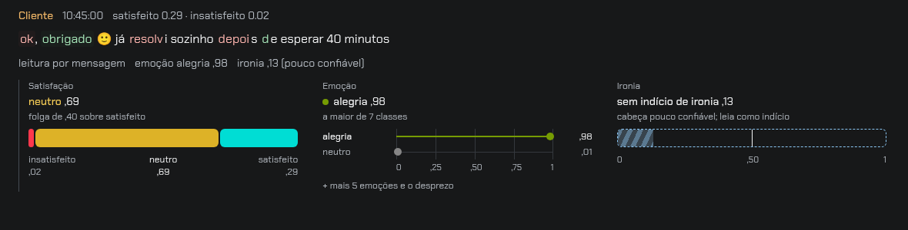

# Guia de uso

O Fraus ajuda a examinar atendimentos de chatbot e **estima satisfação** a
partir das conversas. Não pergunta a nota ao cliente, não revela seu estado
real e **não avalia o desempenho de atendentes**. Para entender a evidência e
seus limites, consulte o [cartão do modelo](cartao-do-modelo.md) e as
[limitações](limitacoes.md).

## Acesso e permissões

A página inicial (`/`) apresenta o método, exemplos e limites. **Conhecer a
análise** percorre a apresentação; **Entrar** ou **Entrar no Fraus** abre
`/entrar`, e **Criar conta** abre `/cadastrar`. Os exemplos vêm de um snapshot
local: não são uma consulta aos atendimentos da sua conta.

Quando o login estiver habilitado, entre com e-mail e senha. No cadastro,
informe nome, e-mail e senha de pelo menos oito caracteres; o **Código de
acesso** pode ser exigido pela instalação. Use somente o código que recebeu
da administração. Um link de equipe (`/convite/[token]`) mostra equipe, papel,
canais e validade; entre ou crie a conta e aceite o convite com uma sessão de
usuário válida. Login não configurado não permite aceitar convite por uma
credencial técnica. Não envie senhas ou chaves junto com arquivos de atendimento.

Existem duas permissões diferentes:

- **Papel global:** `usuario` (analista) ou `dev` (desenvolvedor). Ambos têm as
  tarefas de acompanhamento, análise e a tela **Modelo**. **Integrações** e
  **Configurações**, gerar a chave do Tars e remover um atendimento exigem
  `dev`. Algumas abas de Operação também são exclusivas de `dev`.
- **Papel na equipe:** proprietário, gestor ou membro. Essa hierarquia governa
  ações sobre a equipe; **ser proprietário não transforma a conta em `dev`**.
  Controles de gestão dependem do papel informado pelo servidor, não apenas de
  conseguir abrir Operação.

Os canais autorizados também delimitam quais conversas cada pessoa pode ver.
Uma conta criada por convite começa sem acesso às conversas; aceitar o convite
atribui os canais cadastrados na equipe, respeitando políticas administrativas
explícitas. Equipe sem canais não libera todo o histórico. Se faltar acesso,
peça a quem administra a instalação que confira a equipe e os canais — não é
motivo para reenviar os mesmos dados.

Na lateral ficam **Visão geral**, **Atendimentos**, **Analisar**, **Grafo** e
**Modelo**, também para `usuario`. Abra o **menu da conta**, no rodapé, para
**Operação**, Integrações e Configurações conforme sua permissão. **Documentação**
aparece quando há endereço configurado; **Sair**, quando há usuário conectado.

**Usar tema claro** e **Usar tema escuro** alternam a aparência da dashboard.
A preferência fica neste navegador; a apresentação e as páginas de acesso
continuam escuras. Isso não comprova legibilidade no projetor da banca:
o ensaio físico continua necessário.

## Analisar um arquivo

1. Abra **Analisar** e arraste o arquivo à área de envio ou use **Escolher
   arquivo**. O seletor aceita CSV/TSV, planilhas XLSX/XLSM, JSON/JSONL, TXT,
   DOCX e PDF; a identificação do conteúdo depende do formato real do arquivo.
   Conversas exportadas do WhatsApp entram como arquivo de texto.
2. Aguarde a leitura. Há limite de **200.000 bytes por arquivo**; se a tela
   informar excesso, divida o conteúdo em partes menores preservando as
   conversas e seus horários.
3. Se a associação das colunas for confiável para o servidor, a análise segue
   automaticamente. **Com horários válidos, a tela solicita também a gravação**.
   Não existe uma segunda confirmação manual antes dessa tentativa de salvar.
4. Se houver dúvida, aparece **Conferir colunas**. Nada foi gravado nessa
   etapa. Confira **Fala** e **Quem falou**; em **Mais colunas: data, conversa e
   canal**, ajuste os campos disponíveis. Sem identificador de conversa, o
   arquivo é tratado como uma conversa só. Confira também a ordem dia/mês ou
   mês/dia quando perguntada, a amostra e os avisos de linhas rejeitadas.
5. Use **Analisar** para confirmar a conferência. Depois do resultado,
   **Estão erradas? Ajustar**, quando disponível, reabre a associação;
   **Trocar arquivo** abre outro envio. **Ajustar colunas** também pode aparecer
   na recuperação de erro.

Confira **Análise parcial do arquivo**, quando aparecer: cada análise aceita
até **10 atendimentos e 40 mensagens do cliente**, preservando atendimentos
inteiros. A tela informa quantos foram analisados; divida o restante para não
confundir um resultado parcial com a leitura do arquivo inteiro.

Em **Conversa**, os detalhes da análise e os sinais por mensagem começam
abertos. **Ocultar detalhes da análise** simplifica a leitura;
**Recolher os sinais** fecha os painéis, e **Abrir todos os sinais** os reabre.
Cada fala do cliente oferece a **leitura por mensagem**, com três gráficos:
**Satisfação** (faixa dividida em insatisfeito, neutro e satisfeito),
**Emoção** (linha com ponto, da mais forte para a mais fraca) e **Ironia**
(medidor tracejado, leitura pouco confiável). Eles descrevem aquela fala;
a nota do atendimento vem do conjunto da conversa.

!!! warning "Arquivo sem horário: leitura avulsa"
    Sem horário das mensagens não há latência, **nota da conversa nem gravação
    nos indicadores**. A leitura por mensagem continua disponível. Não invente
    datas para obter uma nota; prefira exportar novamente com os horários reais.

A confiabilidade da leitura de colunas não é confiança estatística na
classificação. Confira os avisos mesmo quando o fluxo seguir automaticamente.
O tratamento de dados pessoais reduz exposição, mas não dispensa autorização
para enviar os arquivos nem revisão das regras da organização.

## Confirmar o que foi salvo

A confirmação **“atendimento(s) salvo(s) nos indicadores”** informa a quantidade
salva e oferece **Ver indicadores**, **Ver atendimentos** e **Ver grafo** já no
período do lote. Reenviar a mesma conversa é deduplicado pelo contrato de
registro; isso não substitui conferir o resultado e o período.

**“Gravação não confirmada”** significa que a resposta não confirmou a
persistência. Não apresente esses atendimentos como já incorporados aos
indicadores. **“Análise concluída sem salvar nos indicadores”**, acompanhada do
aviso de ausência de horários, é o resultado avulso esperado, não um zero de
satisfação.

Expanda **Dados do atendimento** para horários e esperas e **Como o resultado
foi calculado** para contribuições e vocabulário. Probabilidades por mensagem
e contribuições do fusor são objetos diferentes. O destaque por oclusão mostra
o efeito de retirar uma palavra na leitura do modelo, não a causa da satisfação
do cliente nem a influência causal de palavras isoladas.

## Encontrar o período e os atendimentos

Use os campos **De** e **até**, **Últimos 7 dias**, **Últimos 30 dias** ou
**Todo o período**. Os atalhos terminam no **último dia com dados disponível
na consulta, não em hoje**; as datas aparecem na tela. Isso permite trabalhar
com um arquivo histórico sem obter um recorte vazio por engano. O período
acompanha a navegação entre as telas pelos parâmetros da URL.

Se houver dados fora do recorte, **Limpar período** volta ao histórico
disponível. Se realmente não houver atendimentos acessíveis, a orientação
oferece analisar o primeiro arquivo e, para quem pode configurar, conectar uma
fonte. **Falha da API não é banco vazio**: a tela deve mostrar a falha, não
concluir que não existe histórico.

### Visão geral

Em `/dashboard`, os cartões mostram **NPS inferido**, **CSAT estimado**,
**Contenção** e **Latência mediana**. A contagem com/sem sinal acompanha o NPS;
os controles de informação explicam método e denominadores. Contenção observa
a ausência de transferência, não prova resolução ou satisfação.

Use **NPS inferido × latência mediana, por dia**, **Distribuição das notas
inferidas** e **Piores atendimentos do período** para escolher casos para
leitura. A influência agregada dos sinais fica em **Modelo**, não nesta tela.

### Atendimentos e detalhe

Em `/dashboard/atendimentos`, busque por ID, canal, desfecho ou categoria,
filtre categoria e desfecho, ordene pelos cabeçalhos e avance pela paginação.
**Exportar CSV** exporta as linhas filtradas, não só a página visível.
Para `usuario`, a API exige autorização temporária de exportação por `dev`.

Abra o ID para ver o resumo e a **Transcrição**. A espera aparece junto à
resposta. Os sinalizadores mostram as regras disparadas e as mensagens
envolvidas. “Não avaliados” por falta de fala do cliente é diferente de
“nenhum disparou”. As regras não julgam atendentes nem alteram a nota.

**Evidência fraca** aponta pouca fala observável para sustentar a leitura, não
uma probabilidade calibrada. **Leitura contestada** avisa de elogio saturado
contra espera longa, não confirma ironia. As duas marcas preservam a nota;
não as confunda com ausência de sinal ou com a abstenção conformal.

Expanda **Por que esta nota?** para consultar:

- a confiança da leitura, quando o artefato compatível estiver disponível;
- **Falas que inclinaram a nota**, pelo saldo das probabilidades do
  classificador de texto;
- **Contribuições das features neste atendimento**, específicas desse caso,
  e as frases de explicação por template;
- o campo **E se a primeira resposta tivesse chegado em**, em segundos:
  **Calcular** compara o cenário com o original sem gravar. A API recusa
  conversa ou hipótese fora da faixa admitida, ou caso sem resposta ajustável.

A decomposição do modelo não demonstra causa no cliente. Os efeitos por família
não somam a nota. **Leitura sem confiança suficiente** informa abstenção,
mas o atendimento continua contando no NPS. Sem artefato ou rota disponível,
a tela informa que não há confiança disponível; isso não é garantia de acerto.

**Todos os atendimentos** retorna à lista. **Remover atendimento** é ação de
`dev`: exige **Confirmar remoção**, sai dos indicadores, não tem desfazer e fica
auditada. Não use remoção como etapa automática de migração de uma integração.

### Grafo

Em `/dashboard/grafo`, **Grafo da memória** explora os registros e suas relações.
**Todas**, **Léxico**, **Domínio** e **Proveniência**, quando presentes, mudam o
foco, não removem os demais nós. Confira a legenda de tipos e a contagem de
termos: **grafo truncado** indica que nem todos foram desenhados.

Selecione um nó para abrir a ficha; nós de atendimento oferecem **Abrir o
atendimento**. A lista acessível por teclado seleciona os mesmos nós do desenho.
O grafo não é uma validação independente da classificação.

## Interpretar os números sem inventar certeza

- **Score, nota e categoria** vêm do servidor. As faixas de fábrica são
  0–6 detrator, 7–8 neutro e 9–10 promotor; a instalação pode configurar outras
  faixas válidas. Não recalcule categorias por uma regra própria na planilha.
- **Sem sinal não é zero.** Ausência de fala informativa do cliente pode deixar
  score e nota ausentes, inclusive em encerramentos de mera cortesia. Esses
  casos não pertencem a uma categoria nem devem ser somados como detratores.
- **NPS inferido é estimativa**, não resposta a uma pesquisa. O cartão oculta o
  ponto com menos de **30 atendimentos com sinal**. O intervalo **AW(3,T)** mede
  incerteza amostral, **não o erro do classificador** nem uma garantia de acerto.
- Emoção é uma classificação textual auxiliar; não é leitura biométrica nem
  prova do estado real da pessoa. A ironia é exibida por mensagem, mas não
  entra no vetor que calcula a nota.
- Compare NPS e latência no conjunto, e leia casos individuais antes de agir.
  Associação entre tema, espera e satisfação não demonstra causalidade.
  O sinal de tempo foi treinado em conversas sintéticas, não em atendimentos
  reais rotulados com satisfação.
- **Sem resposta não há latência medida.** Uma conversa pode ter horários e
  nota sem ter recebido resposta; a espera ausente não equivale a resposta
  instantânea. Não substitua o campo vazio por zero na exportação.

## Consultar o Modelo

**Modelo** (`/dashboard/modelo`) está disponível a `usuario` e `dev`, dentro da
dashboard; não é uma rota anônima. **Classifique uma frase** permite explorar os
sinais com uma única consulta de classificação, sem salvar. A visualização é
didática: não observa atenção ou ativações internas e não transforma a frase
em nota de atendimento.

Expanda **Como o modelo foi avaliado** para consultar estado dos artefatos,
pesos globais, **Métricas do treino**, **Faixas de NPS e classes**,
**O que influenciou as notas** (botão **Ver influência dos sinais**, sobre todo
o histórico acessível) e lexicon de emoji. Peso global não explica um
atendimento: use o detalhe para isso. Há oito famílias observadas, mas sete
famílias e 39 features no vetor; ironia permanece leitura por mensagem.
Curadoria do léxico continua exclusiva de `dev`.

Desde 16/11/2026, retreino, calibração, promoção e troca de modelos estão fora
da fila por decisão do projeto. As limitações científicas não foram resolvidas
por esse congelamento.

## Trabalhar na Operação

Abra menu da conta → **Operação** (`/dashboard/operacao`). As abas comuns são:

| Aba | O que fazer |
|---|---|
| **Radar** | Ler temas recorrentes, expandir **Evidências e NPS estimado** e **Abrir investigação com evidências**. O impacto compara o tema ao restante do recorte; é associação, não causa, e exige amostra suficiente nos dois lados. |
| **Investigações** | Abrir uma investigação, selecionar evidências, responsável e prazo, registrar ações e acompanhar estados e antes/depois. A diferença é descritiva, não prova efeito da ação. |
| **Equipe e escala** | Simular turnos, pessoas, duração e custo sobre a demanda histórica; consultar equipes e competências. Em **Hierarquia e convites**, os controles respeitam seu papel na equipe. |

Criar/editar o cadastro administrativo de equipes e seus canais depende de
`dev`. Proprietário e gestor podem usar a gestão permitida na hierarquia sem
ganhar esse papel global. Links de convite têm validade e limite de pessoas;
compartilhe-os somente com os destinatários e revogue-os quando necessário.

Somente `dev` vê também:

| Aba | Limite da ferramenta |
|---|---|
| **Jornadas** | Vincula contatos por referência pseudônima explícita; não identifica pessoas pelo texto. Não informe nome, telefone, e-mail ou CPF. |
| **Replay** | Recalcula prefixos da conversa e permite avançar pelas mensagens. A marca de deterioração é retrospectiva, nunca alerta ao vivo; há limite de 80 mensagens, até 40 do cliente. |
| **Laboratório** | Compara cenários de espera ou ocultação de fala sem alterar o banco. **Comparar fusores** exige candidato compatível no servidor; a presença do controle não implica candidato disponível nem autoriza reabrir a fila de modelos. |
| **Acessos** | Consulta alcance, políticas e auditoria; permite administrar acesso por canal, janela de exportação e revogação de sessões. |

## Integrações e Configurações

Ambas ficam no menu da conta e são de `dev`.

Em **Integrações** (`/dashboard/integracoes`), o cartão **TARS** vem primeiro.
Expanda **Outras integrações: webhook assinado para qualquer plataforma** para
cadastrar fontes por nome, canal e tipo. O campo de segredo recebe o **nome da
variável de ambiente**, nunca seu valor. “Variável definida” confirma presença,
não a validade da credencial.

Selecione uma fonte para renomear, ativar/desativar, remover o cadastro e
gerenciar a **Chave de API** do envio direto. Para fonte de webhook, há também
**Segredo de assinatura**, **Contrato do webhook** e **Entregas**. As chaves
em claro aparecem uma única vez; gerar outra invalida a anterior. Remover a fonte
não apaga atendimentos que já entraram. **Entregas** é o histórico do webhook,
não uma confirmação de envio direto do Tars.

Não há formulário de importação por caminho de pasta nesta tela.
Arquivos do computador entram por **Analisar**.

Em **Configurações** (`/dashboard/configuracoes`), consulte **Autenticação** e
**Chaves de acesso**, respeitando as credenciais administrativas exigidas para
cada operação. Ajuste **Faixas de NPS** e **Limiares de latência** e confirme
em **Salvar faixas** ou **Salvar limiares**. **Voltar ao padrão de fábrica**
preenche o rascunho: ainda é preciso salvar. Faixas devem cobrir 0 a 10 sem
buraco ou sobreposição; limiares devem crescer em segundos. A API valida e
informa o motivo da recusa.

Essas mudanças afetam a leitura e a exibição, não recalculam o score gravado.
Não há controle para corrigir uma nota, desligar sinais ou trocar pesos.
Configuração de autenticação não é permissão para compartilhar chaves.

## Participar da anotação de ironia

Um link pessoal `/anotar/[token]` abre uma tarefa separada, sem conta da
dashboard. O link de grupo `/anotar/grupo/[token]` prepara um link pessoal.
Guarde seu endereço pessoal para continuar em outro aparelho e não o publique.

Responda **Irônico**, **Não irônico** ou **Depende do contexto**, também pelas
teclas **1**, **2** e **3**. **Voltar** permite rever a resposta anterior; a tela
confirma quando as respostas foram salvas. Essa coleta não muda a nota dos
atendimentos nem treina ou promove automaticamente um modelo. A ferramenta
continua no código, mas trabalho de modelos está fora da fila vigente.

## Quando algo não responde

Se aparecer um aviso de indisponibilidade, aguarde e use a tentativa de
reconsulta oferecida. Um serviço pode responder à sondagem de saúde e ainda
não conseguir carregar seus modelos para analisar; isso não confirma uma
inferência bem-sucedida. Não troque ausência de resultado por nota zero.

No erro de arquivo, leia a causa e use **Tentar de novo** para reenviar o
último arquivo ou **Escolher outro arquivo**. Quando oferecido, **Ajustar
colunas** recupera a conferência. Se o erro persistir, encaminhe a mensagem de
erro e o formato do arquivo ao responsável, sem compartilhar conversas ou
credenciais fora dos canais autorizados.

## Receber conversas do Tars

Quem tem papel `dev` pode abrir menu da conta → **Integrações** → **TARS** →
**Conectar o TARS**. A chave é mostrada uma única vez: use-a na configuração do
Tars, não em um arquivo de atendimento. Siga os passos e os limites de
privacidade em [Integração com o Tars](integracao-tars.md). Se esse destino não
aparece, solicite a configuração a uma pessoa autorizada; o papel de equipe
sozinho não concede essa permissão.

## Escopo deste guia

Este guia descreve os controles e contratos conferidos no código em
**16/11/2026**. A dashboard e a API publicam separadamente: presença no
repositório **não prova publicação em produção**. Esta revisão foi documental,
sem executar análise, gravação, testes ou deploy. Resultados científicos e seus
limites ficam em [Generalização e evidências](generalizacao.md).
