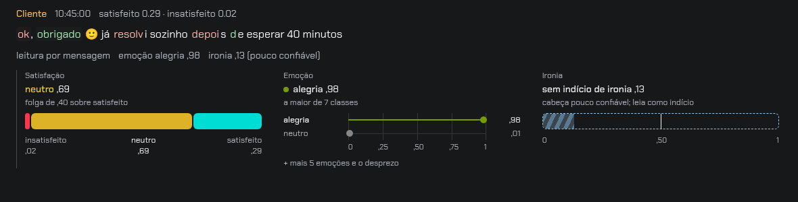
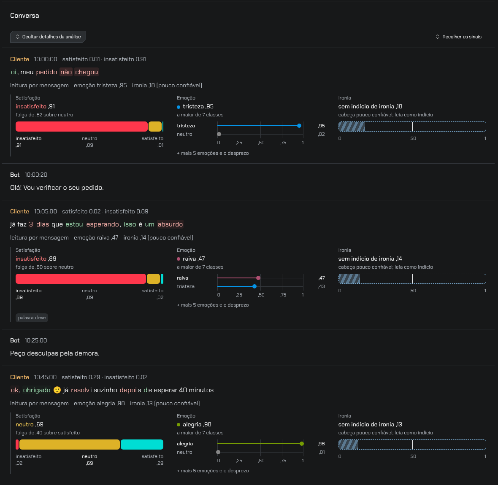
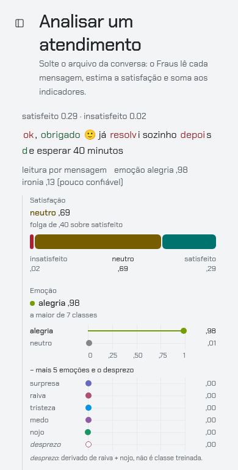
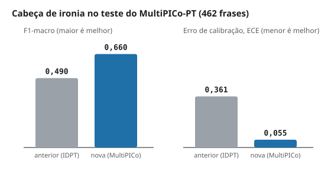
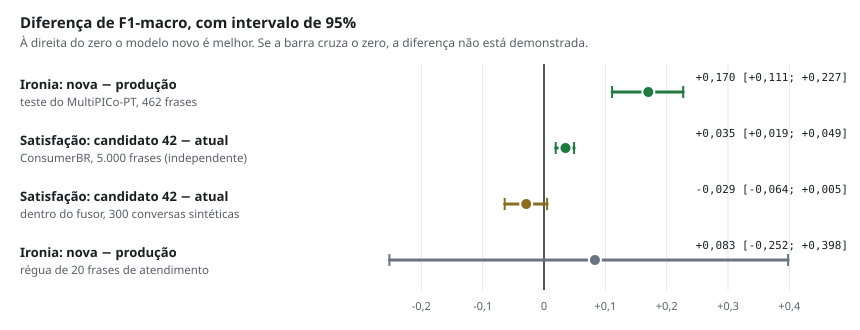

# Novidades de 13/11/2026

Três mudanças nesta atualização: o leitor de ironia que está no ar foi trocado
por um melhor, a tela que mostra a leitura de cada fala foi redesenhada, e um
candidato a novo leitor de satisfação foi medido e **não** foi adotado. Esta
página mostra as imagens e os números de cada uma.

!!! info "O que não mudou"
    Nenhuma nota, categoria ou NPS mudou. A ironia é mostrada por mensagem e
    não entra na conta da nota; os leitores de satisfação e de emoção e o
    fusor continuam os mesmos.

## 1. Leitura da fala em três gráficos

Antes, satisfação, emoção e ironia dividiam uma única régua, com dez linhas
iguais. Agora cada pergunta tem o seu gráfico:

- **Satisfação:** uma faixa dividida em três partes (insatisfeito, neutro,
  satisfeito). O tamanho de cada parte é a probabilidade daquela classe.
- **Emoção:** uma linha com um ponto na régua de 0 a 1, da emoção mais forte
  para a mais fraca. As demais abrem em "mais emoções".
- **Ironia:** um medidor tracejado com a marca em 0,50. O tracejado avisa que
  essa é a leitura menos confiável das três.

Na tela **Analisar**, os gráficos aparecem abertos embaixo de cada fala do
cliente, sem precisar clicar:

No celular os gráficos ficam um embaixo do outro; a imagem mostra os dois
primeiros no tema claro:

{ width="300" }

As imagens foram feitas com uma conversa de exemplo, escrita para o teste, lida
pelo motor real numa instalação local. Não são atendimentos de clientes.

!!! note "Um exemplo do limite do sistema"
    Na última fala da imagem, "ok, obrigado 🙂 já resolvi sozinho depois de
    esperar 40 minutos", o leitor de emoção respondeu alegria e o de ironia não
    viu indício. É o tipo de frase que motivou o projeto, e os leitores por
    mensagem ainda erram nela. Ver [Limitações](limitacoes.md).

## 2. Leitor de ironia novo no ar

O leitor de ironia que estava publicado era o de agosto, treinado em um
conjunto de tweets em que a fonte entregava a resposta (ver
[Ironia: corpus e régua](ironia.md)). Ele foi trocado pelo leitor treinado no
**MultiPICo**, um conjunto de respostas de redes sociais.

Os dois foram medidos com os mesmos arquivos que rodam no servidor:

| Teste | Frases | Leitor anterior | Leitor novo | Diferença de F1 [intervalo de 95%] |
|---|---:|---|---|---|
| MultiPICo-PT | 462 | F1 0,490 · ECE 0,361 | F1 0,660 · ECE 0,055 | **+0,170** [+0,111; +0,227] |
| Régua de 20 frases de atendimento | 20 | F1 0,437 | F1 0,520 | +0,083 [−0,252; +0,398] |

**F1** vai de 0 a 1 e quanto maior, melhor. **ECE** mede o quanto a confiança
do modelo erra; quanto menor, melhor.

Como ler:

- No MultiPICo o leitor novo é melhor e o intervalo fica todo acima de zero.
- Esse teste vem do mesmo conjunto em que o leitor novo estudou (as frases de
  teste são outras), então para ele é um teste "da casa".
- A régua de 20 frases é pequena demais: o intervalo vai de −0,25 a +0,40 e
  não permite concluir nada.
- O leitor continua pouco confiável em frases de atendimento. Por isso a tela
  mantém o aviso e a ironia continua fora da nota.

## 3. Candidato de satisfação: medido e não adotado

Um leitor de satisfação treinado com mais dados (chamado aqui de candidato 42)
foi comparado com o atual em dois lugares.

| Onde | O que é | Atual | Candidato 42 | Diferença de F1 [intervalo de 95%] |
|---|---|---:|---:|---|
| ConsumerBR | 5.000 reclamações de consumidor, dados "de fora" | 0,539 | 0,573 | **+0,035** [+0,019; +0,049] |
| Dentro do fusor | 300 conversas sintéticas, nota final | 0,940 | 0,911 | −0,029 [−0,064; +0,005] |

O candidato ganha nos dados de fora e fica abaixo quando entra na conta da
nota. O motivo é o mesmo nos dois testes: ele acerta mais quem está satisfeito
ou insatisfeito e erra mais o **neutro**.

| Acerto na classe neutra | Atual | Candidato 42 |
|---|---:|---:|
| ConsumerBR | 0,37 | 0,16 |
| Dentro do fusor | 0,91 | 0,76 |

Neutro é a faixa 7–8 do NPS. Um leitor que joga neutro para "satisfeito" faz o
indicador principal parecer melhor do que é. Por isso o candidato **não foi
adotado**; o próximo passo é um ajuste que recupere o neutro.

Uma ressalva a favor do candidato: o teste dentro do fusor usa frases de um
conjunto que o leitor atual pode ter visto no treino antigo, então o número do
atual ali é otimista.

## As quatro comparações num gráfico

O ponto é a diferença medida e a barra é o intervalo de 95%. Só as duas
primeiras linhas mostram ganho demonstrado.

## Onde ler mais

- [O Fraus explicado para todos](explicado-para-todos.md): a ideia e os testes em linguagem simples.
- [Generalização e evidências](generalizacao.md): as tabelas completas das campanhas de treino.
- [Cartão do modelo](cartao-do-modelo.md) e [Limitações conhecidas](limitacoes.md).
- [Guia de uso](guia-de-uso.md): como analisar um arquivo.
