# LP e dashboard — antes e depois

**16/10/2026 · direção FR aprovada no protótipo v3 e aplicada ao produto.**

A versão anterior usava o vocabulário do **Instrumento**: orbe, fósforo de
osciloscópio, rótulos monoespaçados e números em sete segmentos. A nova direção
faz do **FR oficial** a assinatura visual: matéria clara e champanhe sobre
grafite, letras quadradas e pinceladas diagonais. Na ferramenta, a expressão da
marca fica no chassi; não há uma cena competindo com os dados.

Este registro compara implementação e composição. **Não é um estudo de
usabilidade, uma medição de acurácia ou uma prova de publicação em produção.**
As regras vigentes estão em [Design da interface](design.md).

## Condições da comparação

- **Antes:** produto exportado da revisão `e5aa19d859e1f5cc402958a16ae43450abc9a905`,
  sem alterar seu desenho. Capturas em servidor de desenvolvimento; o pequeno
  indicador circular do Next não faz parte da identidade do produto.
- **Depois:** build de produção local do redesign, na mesma máquina e Chromium.
  Não houve deploy nesta entrega.
- **Enquadramento equivalente:** desktop de 1440 × 900 e celular de 390 × 844
  pixels CSS, escala de captura 1,25. Cada par mostra o mesmo tamanho de viewport.
- **Dados iguais:** snapshot de demonstração versionado, 64 conversas sintéticas,
  sendo 59 com sinal e cinco sem sinal; período completo de 01/08 a 22/08/2026.
  O banco foi copiado para uma instância temporária compartilhada pelas duas
  interfaces, sem reanalisar ou modificar as conversas.
- **Proveniência do snapshot:** SHA-256
  `a18a4fa04e0a4ba74f145625727ba6812893327f7cf9c87a22849f08e2fbe9ef`.
- A API de demonstração identifica explicitamente **motor dublê — números
  sintéticos**. Esses números servem para conferir a interface, não são
  resultados de clientes reais nem validação do classificador.
- A LP estava **sem snapshot válido de leituras gravadas**. As duas versões
  mantêm ausência explícita; nenhum resultado foi criado para preencher a tela.

Clique nas imagens para abrir a captura em tamanho original.

## Landing page

| Antes — Instrumento | Depois — FR |
|---|---|
| [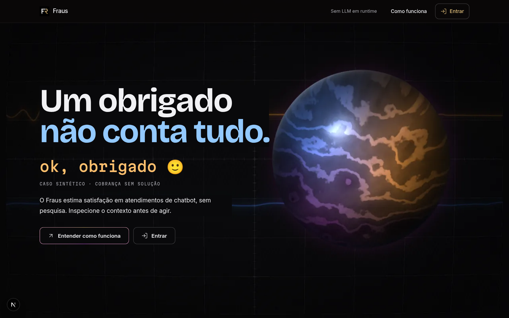](assets/redesign-2026-10-16/lp-antes.png) | [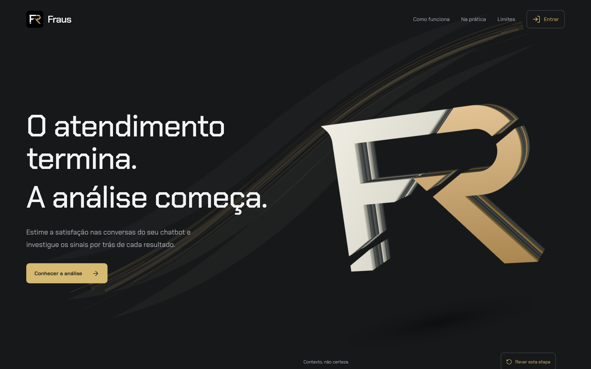](assets/redesign-2026-10-16/lp-depois.png) |

### O que mudou

| Aspecto | Anterior | Nova direção |
|---|---|---|
| Assinatura | Orbe e linguagem de instrumento | Monograma FR oficial, com sua fenda diagonal, extrudado em camadas |
| Tipografia | Contraste entre display, prosa e rótulo mono | Chakra Petch local, quadrada, nos títulos, texto e controles |
| Fundo | Retícula e fósforo de osciloscópio | Composição SVG de pincel do cabeçalho ao fecho |
| Abertura | O caso “obrigado” abria a tese | Abertura de produto; o exemplo de linguagem ganha sua própria seção |
| Conteúdo | Narrativa técnica e cena de partículas | Contexto → sinais → uso na ferramenta → limites, com widgets e ícones |
| Movimento | Cena WebGPU e regimes de pôster | Um canvas WebGL sob demanda em contexto elegível; poses WebP no celular, em reduce ou em backend de software |
| Ações | Entender o método e acessar a conta | Método, dashboard, entrar e criar conta, com destinos reais |

As camadas do FR são **arte de marca**, não uma visualização das famílias ou
features. Não se atribui significado estatístico à quantidade de placas.

### Widgets e leitura

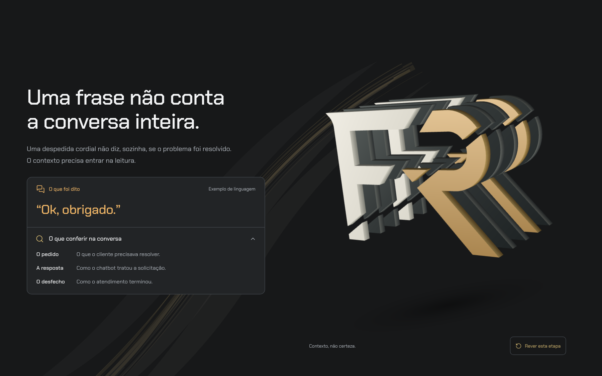

A frase aparece como **exemplo de linguagem**. O detalhe nativo explica o que
conferir na conversa sem afirmar que cortesia seja satisfação ou insatisfação.
Os sinais se dividem em leitura textual da mensagem, contribuições e horários;
probabilidade textual não é apresentada como causa isolada da nota fundida.

Leituras realmente gravadas continuam com seletor, transcrição e procedência.
Sem material válido, a região informa o que falta em vez de simular resultados.

### O fundo não termina no FR

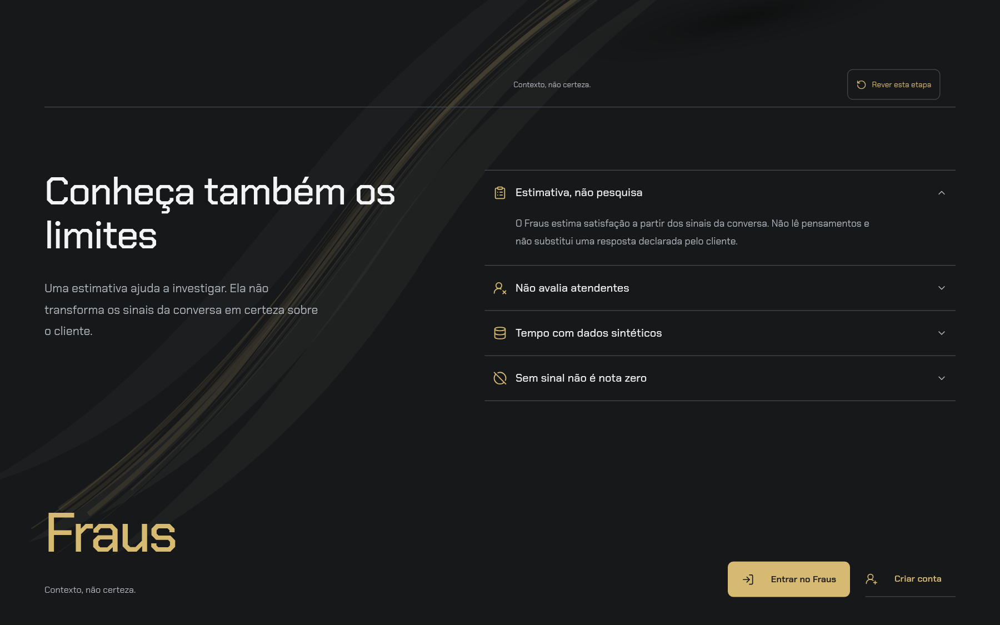

O pincel pertence à raiz inteira da LP, não ao palco sticky. O smoke confere a
altura da camada em relação à página e abre detalhes que mudam o fluxo. Widgets
têm fundo opaco; na composição SVG, o pior contraste calculado do texto
secundário foi **5,41:1**, acima do mínimo de 4,5:1. Isso não substitui verificar
foco, tamanho, composição e legibilidade na tela.

### Celular

| Antes | Depois |
|---|---|
| [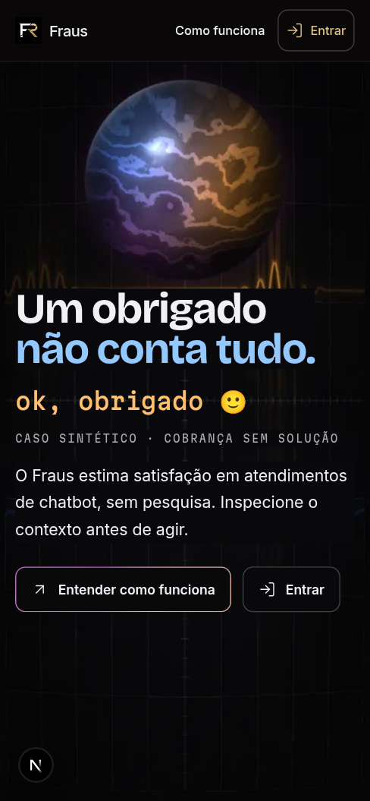](assets/redesign-2026-10-16/lp-antes-mobile.png) | [](assets/redesign-2026-10-16/lp-depois-mobile.png) |

O conteúdo fica em fluxo normal. A marca não exige WebGPU, nem JavaScript para
aparecer. Abaixo de 900px, `picture` seleciona a variante WebP transparente de
800×640, em vez de baixar a imagem desktop de 1280×1024. As imagens inferiores
são carregadas sob demanda. Não há malha escondida no celular apenas porque uma
regra CSS a tornou invisível.

## Dashboard

| Antes — Instrumento | Depois — Escuro |
|---|---|
| [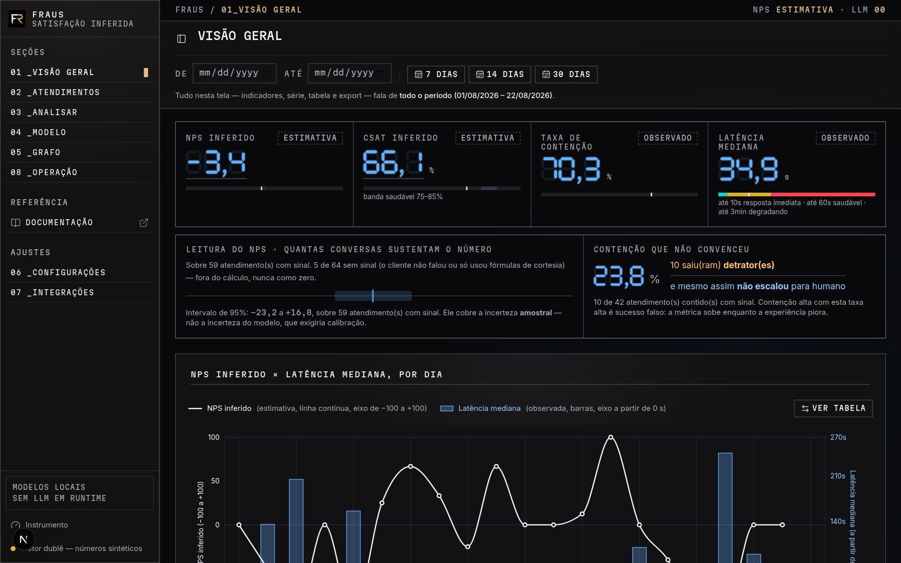](assets/redesign-2026-10-16/dashboard-antes.png) | [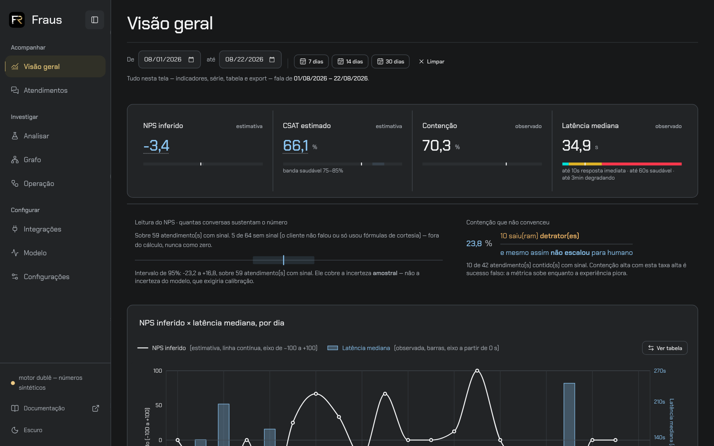](assets/redesign-2026-10-16/dashboard-depois.png) |

| Aspecto | Anterior | Nova direção |
|---|---|---|
| Navegação | Numeração e caixa alta | Sidebar de 224px, rail de 64px e grupos Acompanhar, Investigar e Configurar |
| Valores | Polígonos de sete segmentos | Texto tabular, selecionável e com rótulo acessível |
| Superfícies | Retângulos sem raio e vocabulário de vidro/neon | Regiões opacas, bordas simples e cantos suaves |
| Hierarquia | Instrumentação e telemetria no chassi | Título, filtro e indicadores; NPS × latência continua dominante |
| Temas | Instrumento e Chuva, ambos escuros | Escuro padrão e alternativa Clara |
| Ausência | Display apagado e cabeça vazada | Ausência textual explícita e cabeça vazada, sem virar zero |

Os quatro valores e as ressalvas continuam correspondendo ao mesmo snapshot.
**Mudou a apresentação, não a regra de score, categoria ou agregação.**
A sobreposição NPS × latência permanece; o intervalo continua descrevendo
incerteza amostral, não erro do modelo. Os cinco atendimentos sem sinal ficam
fora da escala de satisfação.

### Alternativa clara

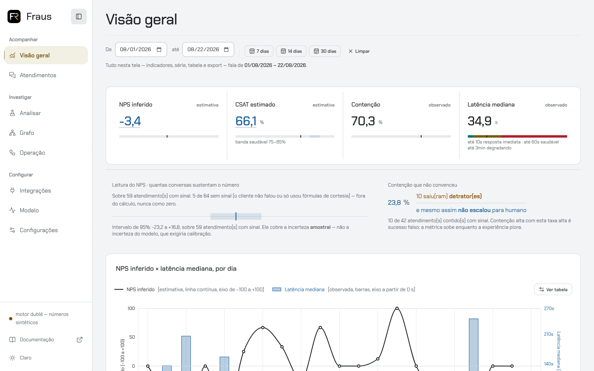

A troca altera o chassi e ajusta a luminância das cores, não o significado das
categorias ou dos sinais. A preferência persiste e sincroniza entre abas. A LP e
o acesso permanecem escuros sem apagar a escolha da dashboard. Valores antigos
de tema retornam ao padrão; não são aliases de novos temas.

### Sidebar e navegação

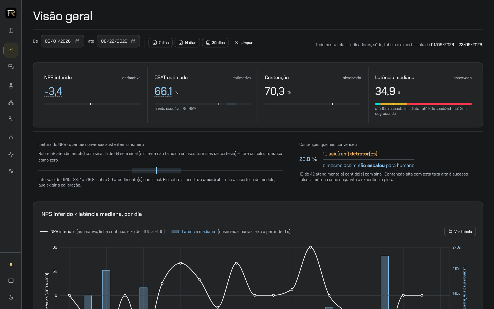

A navegação agrupa tarefas em **Acompanhar**, **Investigar** e **Configurar**.
O último grupo respeita o papel `dev`; usuário comum continua com os cinco
destinos autorizados. O destino atual recebe indicação acessível, inclusive
quando se está no detalhe de um atendimento.

O rail mantém nomes acessíveis e dicas no foco. A escolha de recolher persiste
em cookie e é restaurada pelo servidor após recarregar. `Ctrl/Meta+B` alterna
a barra fora de campos de edição; não intercepta input, textarea, select ou
conteúdo editável. Só o período `de`/`ate` acompanha a navegação: busca, página
e tokens locais não vazam para outra tela. Sessão, tema e aviso completo de
dados sintéticos permanecem disponíveis.

### Um segredo que não mexe nos dados

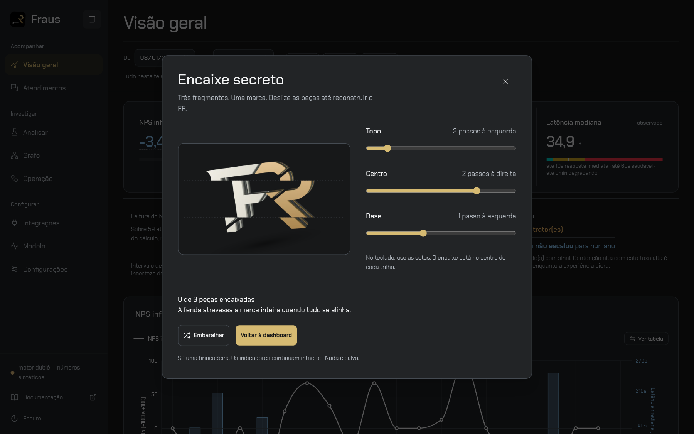

Os cinco cliques na marca continuam descobrindo uma surpresa, agora um
quebra-cabeça: alinhar três fragmentos do FR pelos trilhos e reconstruir a
marca. Setas do teclado também resolvem; Embaralhar oferece outro arranjo.
Não há áudio, cronômetro, gravação ou análise da pessoa.

A antiga encenação que falsificava indicadores e pontuava o ritmo dos cliques
foi removida por completo. Os quatro indicadores permanecem idênticos ao abrir,
jogar, vencer, embaralhar e fechar. Escape fecha apenas o segredo e devolve foco
à marca, mesmo quando aberto de dentro da navegação móvel.


### Celular

| Antes | Depois |
|---|---|
| [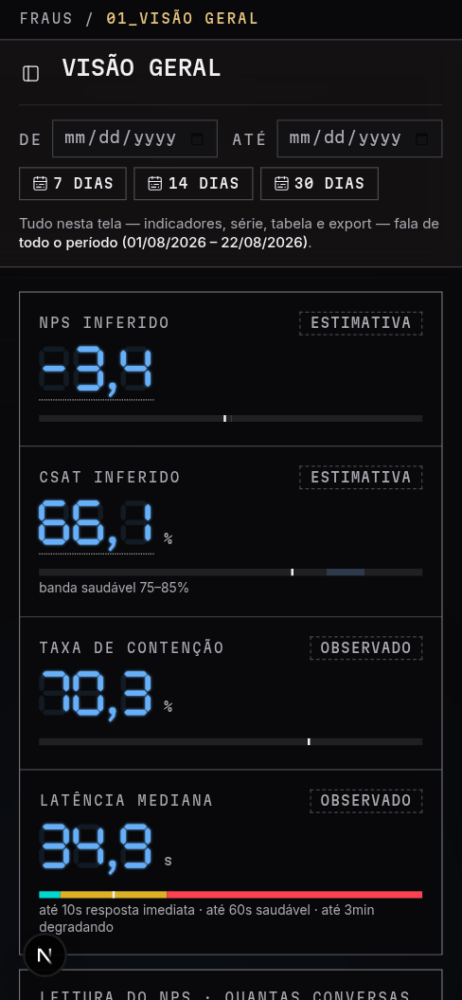](assets/redesign-2026-10-16/dashboard-antes-mobile.png) | [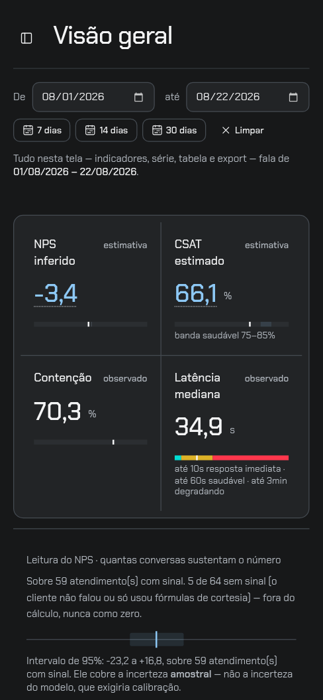](assets/redesign-2026-10-16/dashboard-depois-mobile.png) |

A faixa em duas colunas reduz o empilhamento inicial sem retirar rótulos,
unidades ou explicação de amostra. A navegação abre como painel com foco
contido, botão explícito de fechar e retorno ao acionador por Escape.
Navegar fecha o painel; abrir um destino em outra aba não fecha o painel original.

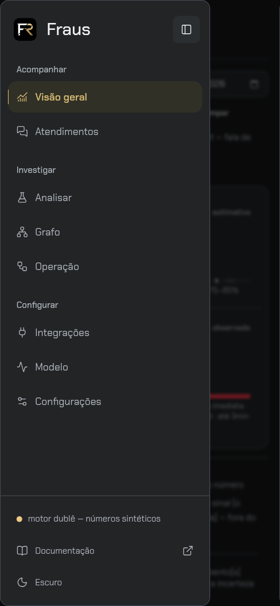

## Otimização da LP aprovada

A primeira redução do porte v3 eliminou quatro esculturas escondidas: de cinco
malhas CSS e 2.475 arestas para uma malha e 495 arestas no desktop; no celular,
nenhuma. **Isso não resolveu o peso percebido.** O ensaio abaixo parte dessa
versão já reduzida, não do Instrumento/WebGPU histórico das capturas “antes”.

Isolar a escultura preservando o layout removeu as pausas de rolagem no
diagnóstico; retirar apenas o pincel não as removeu. O fundo contínuo aprovado
foi preservado. Substituir a malha por WebGL irrestrito também não bastou:
SwiftShader continuou caro. Por isso a implementação final distingue os caminhos:

- **Contexto elegível:** canvas WebGL nativo, um buffer imutável e um draw por
  quadro, culling de faces, geometria preparada só após aceitar o contexto.
  Transições sob demanda, sem loop ocioso, DPR máximo de 1,5 e teto de 1,6 MP.
- **Backend CPU conhecido ou contexto recusado:** poses WebP do mesmo FR,
  acompanhando a seção sem triangulação nem buffers. Não se troca uma malha DOM
  cara por animação 3D em software.
- **Celular, reduce ou sem JS:** arte pré-renderizada. `picture` escolhe
  800×640 abaixo de 900px, em vez de 1280×1024. O hero compacto tem 28.386 bytes;
  não é o peso total da página. Imagens inferiores carregam sob demanda.
- O pôster permanece até o primeiro draw válido e reaparece na perda de
  contexto. Motion continua fora da LP; links públicos não antecipam outras rotas.

### Ensaio controlado de rolagem e carga

Builds de produção locais, Chromium **154.0.8037.57**, contextos novos, cache
desabilitado, CPU limitada em 4×, latência de 150 ms, download de 200.000 bytes/s
(1,6 Mbps), upload de 100.000 bytes/s e escala 1,25. Após rede e fontes prontas,
um percurso cossenoidal de seis segundos percorreu a página inteira e voltou.
Uma execução por viewport e versão; não são medianas de várias execuções.

O navegador deste ensaio usa **ANGLE SwiftShader, sem aceleração física**.
Na versão final, o desktop confirmou `estatico/software`; o celular não montou
o renderizador. Os intervalos abaixo são entre callbacks de `requestAnimationFrame`,
não uma medição direta dos frames apresentados pela GPU.

| Medida | Desktop CSS anterior | Desktop final WebP | Celular anterior | Celular final |
|---|---:|---:|---:|---:|
| Viewport CSS | 1440×900 | 1440×900 | 390×844 | 390×844 |
| Callbacks em seis segundos | 79 | 350 | 361 | 348 |
| Intervalo p95 entre callbacks (ms) | 200,0 | 16,8 | 16,8 | 16,8 |
| LCP de carga fria (ms) | 1.744 | 1.444 | 1.172 | 1.356 |
| CLS | 0,000486 | 0 | 0 | 0 |
| Transferência inicial medida (bytes) | 357.248 | 346.114 | 354.933 | 338.761 |
| JavaScript transferido (bytes) | 170.942 | 172.160 | 166.997 | 166.898 |
| Tempo de tarefas na main thread durante o percurso (s) | 1,171 | 1,797 | 0,686 | 1,886 |

**Resultado observado:** as grandes pausas de rolagem do desktop desapareceram
neste percurso, preservando a marca. Não houve melhora uniforme: o LCP móvel e
o tempo acumulado de tarefas aumentaram; o JavaScript desktop cresceu ligeiramente.
Não se alega redução geral de CPU, memória de GPU, INP ou garantia de 60 FPS.
A transferência inicial não inclui necessariamente todas as imagens lazy
carregadas depois. O ensaio não prova desempenho em aparelho físico ou GPU real.

### Reproduzir a verificação funcional

Com o produto e a API local em execução, dentro de `dashboard/`:

```bash
npm run test:lp
node scripts/validar-navegacao-playwright.mjs
node scripts/validar-segredo-playwright.mjs
# Apenas QA explícito sem aceleração: exercita pixels e ciclo real do WebGL.
# Não mede o caminho padrão nem forja identificação de hardware.
LP_GL_SOFTWARE=1 npm run test:lp
```

O smoke padrão informa quando a política escolheu WebP e quais cenários GL não
foram exercitados. A autorização explícita de software existe no navegador de
QA/exportação, não como parâmetro de produto. “Contexto elegível” também não
comprova GPU física quando o navegador oculta o nome do driver.

## Verificação e limites

- Build de produção e TypeScript concluídos; 323 testes de front aprovados.
- Lint das fontes afetadas e scripts de renderização aprovado.
- Contraste de texto e marcas nos dois temas, e superfícies opacas verificados.
- Smoke padrão da LP concluído em 1280 × 720, 1440 × 900, 390 × 844 e
  320 × 844, cada tamanho normal, com movimento reduzido e sem JavaScript.
- Exercitados teclado, detalhes nativos, ausência de leituras, destinos reais
  e redirect de `/leitura`. No QA WebGL explicitamente autorizado em software:
  retarget, retorno, replay com três quadros distintos e pose final idêntica,
  sem alterar scroll, mudança de movimento em runtime, breakpoint 899/900,
  ausência de loop ocioso e perda/restauração de contexto.
- **Limite do QA forçado:** após esses cenários, o Chromium encerrou a página
  ao abrir o cenário de acesso (`Page crashed` em `page.goto`). A execução
  integral forçada não é declarada aprovada; o cenário de acesso concluiu na
  execução padrão. A causa do crash não foi determinada.
- Dashboard operada em desktop e celular: valores do mesmo recorte, tabela do
  gráfico, navegação móvel, alternância de tema e sincronização entre abas.
- O smoke completo da sidebar passou antes da troca do segredo. Na repetição
  após a troca, o Chromium encerrou ao iniciar o contexto móvel, depois dos
  cenários desktop (`Target page, context or browser has been closed` em
  `page.goto`). Essa repetição não é declarada integralmente aprovada; a causa
  não foi determinada. O smoke do segredo cobre sua integração com a gaveta
  e navegação móvel após fechar o jogo.
- Encaixe secreto resolvido por teclado; arte recomposta, embaralhar/reabrir e
  indicadores preservados; desktop e celular, incluindo Claro e reduce.
- Filtro de sete dias preservado na navegação para atendimentos; amostra
  insuficiente mantém “Sem estimativa”. Período sem conversas mantém ausência,
  e atendimento sem fala do cliente mantém “Sem sinal”, nunca zero.
- Builds internos e públicos da documentação em modo estrito; 46 testes dos
  contratos entre dashboard/modelo e da fronteira documental aprovados.
- Grafo com dados sintéticos operado nos dois temas; navegação LP → dashboard →
  LP preservou a preferência clara da ferramenta e o fundo escuro da LP.
  O dublê informa ausência de eixo aprendido, sem inventar arestas de feature.

**Limites:** não houve estudo com usuários nem teste em aparelho físico. O smoke
validou o estado de ausência da LP, não análises por um checkpoint real. A API de
demonstração e seus números não constituem evidência de qualidade dos modelos.
O site MkDocs, o banner do repositório e os ícones/cartão de compartilhamento
mantêm seus ativos anteriores; o redesign desta entrega cobre LP e dashboard.
